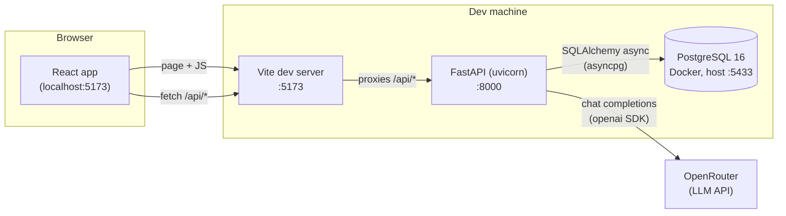
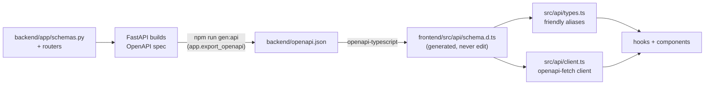
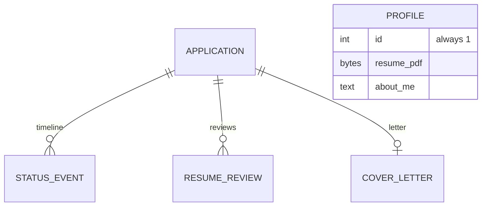
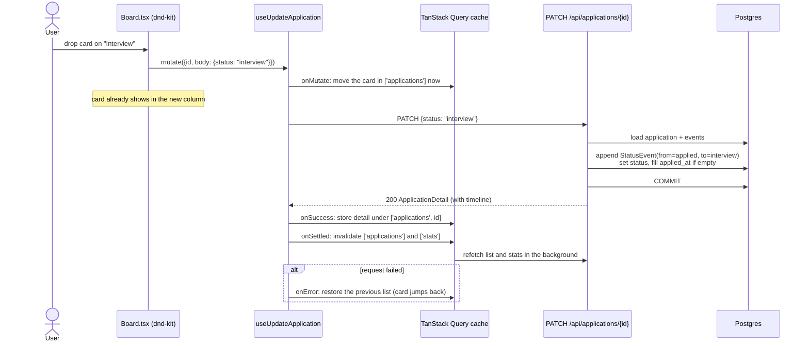
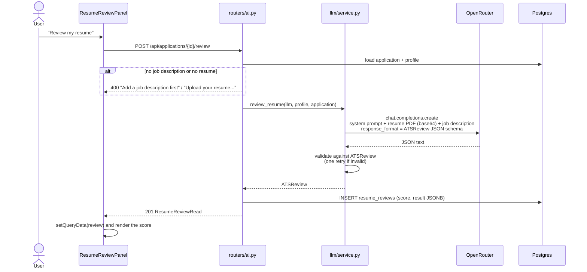

# Architecture overview

Start here. This page explains how the pieces of Job Tracker fit together and follows a few requests from click to database and back. The detailed guides are:

- [BACKEND.md](BACKEND.md): FastAPI app, data model, stats logic, AI features, tests
- [FRONTEND.md](FRONTEND.md): React app, components, data fetching and caching

## The big picture

Job Tracker is a single-user app with three running processes and one external service.



| Process  | What it does | Started by |
| -------- | ------------ | ---------- |
| Postgres | Stores applications, timeline events, profile, reviews, cover letters. Data lives in the `pgdata` Docker volume (kept out of OneDrive on purpose). | `docker compose up -d --wait` |
| FastAPI  | The REST API under `/api`. All business rules live here. | `uv run uvicorn app.main:app --reload --port 8000` |
| Vite     | Serves the React app and forwards every `/api/*` request to port 8000, so the browser only ever talks to one origin. | `npm run dev` |

`start.bat` runs all three in order: start Postgres, apply migrations (`alembic upgrade head`), then open the API and the web app in their own windows.

OpenRouter is only called by the two AI features (resume review and cover letter). The rest of the app works without an API key.

## Repository map

```
job-tracker/
├── start.bat                 one-click start (Windows)
├── docker-compose.yml        Postgres container, port 5433, pgdata volume
├── docker/init-test-db.sql   creates the jobtracker_test database on first start
├── backend/
│   ├── app/
│   │   ├── main.py           FastAPI app, CORS, mounts routers under /api
│   │   ├── config.py         settings from backend/.env
│   │   ├── db.py             async engine, session dependency
│   │   ├── models.py         SQLAlchemy tables + StrEnums
│   │   ├── schemas.py        Pydantic request/response models
│   │   ├── routers/          applications, stats, profile, ai
│   │   ├── llm/              OpenRouter client, prompts, call logic
│   │   └── export_openapi.py writes openapi.json for the frontend
│   ├── alembic/versions/     database migrations
│   └── tests/                pytest, against jobtracker_test
└── frontend/
    └── src/
        ├── main.tsx          React root + TanStack QueryClient
        ├── App.tsx           page shell, view switch, shortcuts
        ├── api/              typed fetch client + generated schema
        ├── hooks/            every query and mutation
        ├── components/       Board, Table, Drawer, modals, AI panels
        └── lib/              status colours, dates, form helpers
```

## The contract between frontend and backend

The frontend never hand-writes API types. The backend's Pydantic schemas are the single source of truth, and a script turns them into TypeScript:



Because `openapi-fetch` is typed from `schema.d.ts`, a wrong path, a missing parameter or a misspelt field is a compile error in the frontend. **After changing a schema or a route, run `npm run gen:api` and then `npm run build`** to see what broke.

## Domain in one minute

- An **Application** is one job you're tracking: company, role, optional details, and a **status** (stage).
- Stages: `wishlist → applied → assessment → interview → offer`, plus two closed stages `rejected` and `withdrawn`.
- Every status change writes a **StatusEvent**. Plain notes ("Recruiter called") are also StatusEvents, just without a `to_status`. Together they form the application's **timeline**.
- **Stats** (interviews, response rate) are computed by replaying the event history, so an application that reached Interview and was then Rejected still counts as an interview.
- The **Profile** is a single row holding your resume PDF and an "about me" note. The AI features send these, plus an application's job description, to the model.
- A **ResumeReview** is a stored ATS-style score for one application (you can run it many times; the latest is shown). A **CoverLetter** is one editable letter per application.



Deleting an application deletes its events, reviews and letter (`ON DELETE CASCADE`).

## Request walkthroughs

### 1. Dragging a card to a new column

This is the most important flow: it shows the optimistic update on the frontend and the event logging on the backend.



### 2. Running a resume review



The frontend also guards this: `AiGate` shows a checklist instead of the panel until a resume is uploaded and the job description is saved.

### 3. Loading the page

1. `main.tsx` creates a `QueryClient` and renders `App`.
2. `App` calls `useApplications()` → `GET /api/applications` (everything, no filters).
3. `StatsStrip` calls `useStats()` → `GET /api/stats`.
4. The board/table and the search box work on the already-loaded list in the browser; search does not hit the server.
5. Clicking a card opens `DetailDrawer`, which fetches `GET /api/applications/{id}` for the full record and its timeline.

## Where to make common changes

| I want to... | Touch these |
| ------------ | ----------- |
| Add a field to applications | `models.py`, new Alembic migration, `schemas.py` (`ApplicationFields`), `npm run gen:api`, `lib/form.ts`, `FormFields.tsx` |
| Add a new stage | `ApplicationStatus` in `models.py`, a migration that alters the Postgres enum, `RANK`/sets in `routers/stats.py`, `lib/status.ts` |
| Add an endpoint | a router in `app/routers/` (include it in `main.py` if new), schemas, tests, `npm run gen:api`, a hook in `useApplications.ts` |
| Change an AI prompt | `app/llm/prompts.py` (keep it byte-stable between calls; see BACKEND.md) |
| Change stage colours | `frontend/src/lib/status.ts` |

## Ports and environment

| Thing | Value |
| ----- | ----- |
| Web app | http://localhost:5173 |
| API + Swagger docs | http://localhost:8000/docs |
| Postgres | `localhost:5433`, user/password/db `jobtracker` |
| Test database | `jobtracker_test` (same server) |
| Config file | `backend/.env` (copy from `.env.example`) |
| AI settings | `OPENROUTER_API_KEY`, `LLM_MODEL` (default `anthropic/claude-sonnet-5.5`) |
