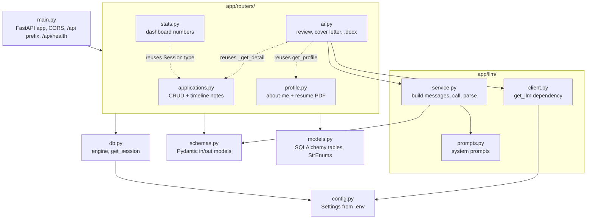
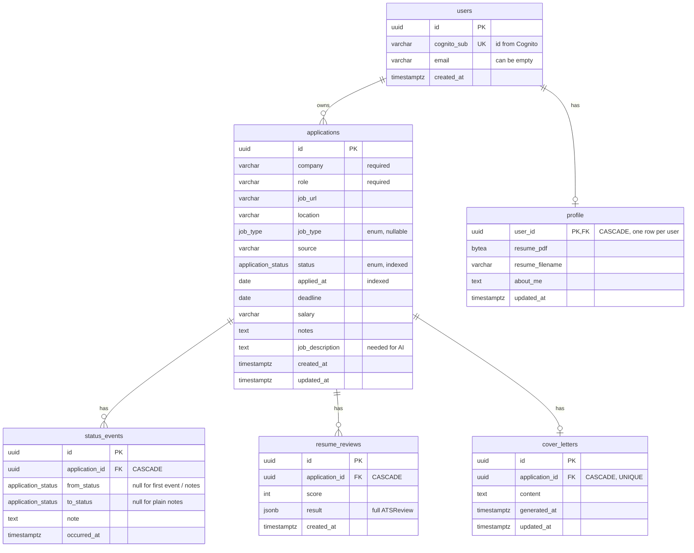
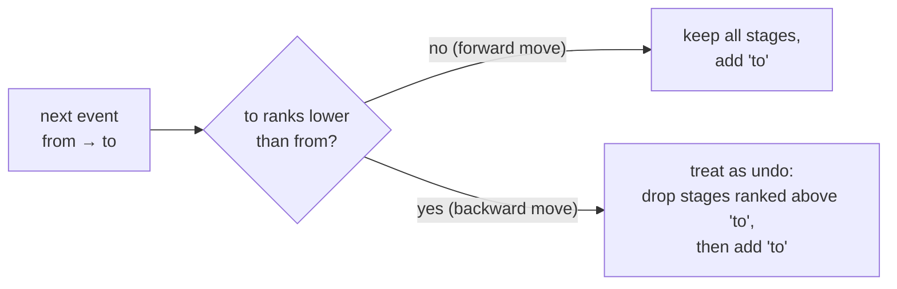
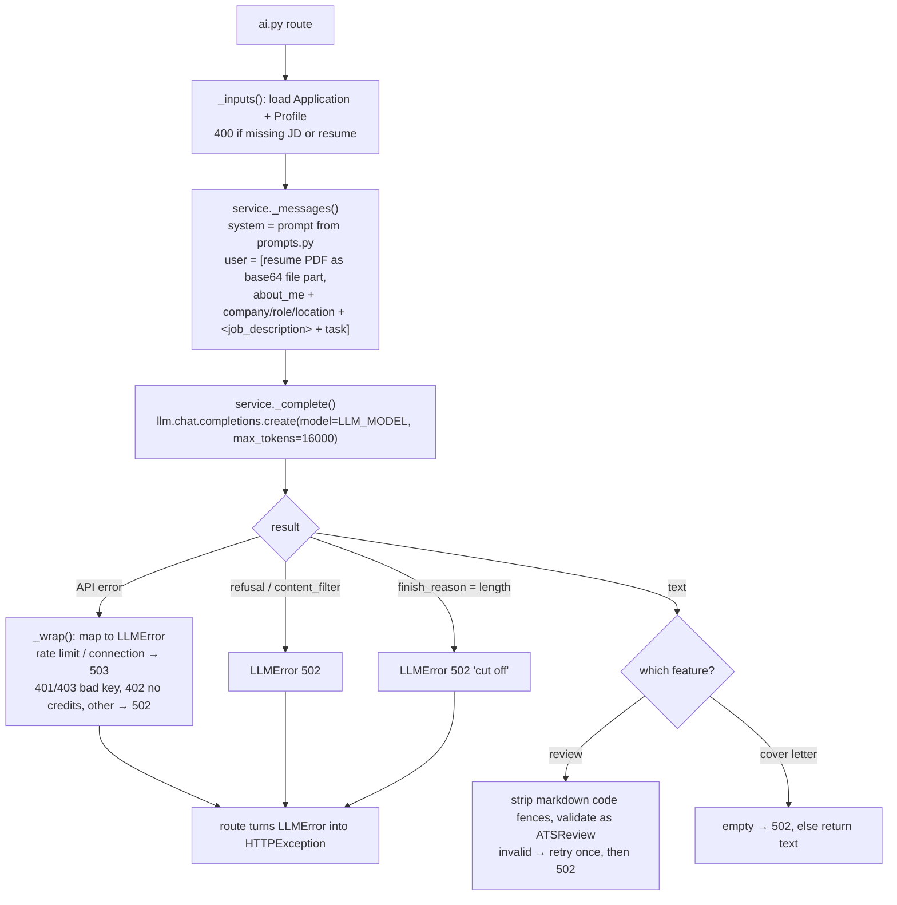
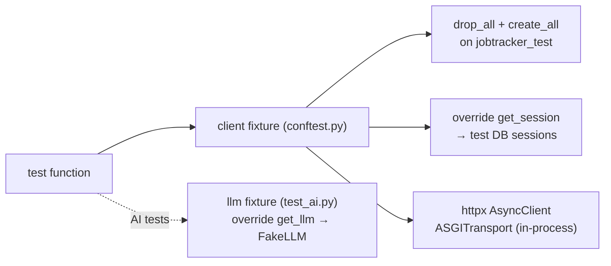

# Backend guide

FastAPI + SQLAlchemy 2 (async) + PostgreSQL, managed with `uv`. Read [ARCHITECTURE.md](ARCHITECTURE.md) first for the big picture.

## Layers



There's no separate "service" or "repository" layer for the normal CRUD: routers query the database directly through the session. Only the LLM work is pulled out into `app/llm/`, because it's the part with real logic (message building, error mapping, retries).

## Files

| File | Responsibility |
| ---- | -------------- |
| `config.py` | `Settings` (pydantic-settings) read from `backend/.env`: `database_url`, `test_database_url`, `cors_origins`, `openrouter_api_key`, `llm_base_url`, `llm_model`, and the login settings (`auth_disabled`, `environment`, `cognito_*`). See `docs/features/01-login-token-check.md`. Imported as the `settings` singleton. |
| `db.py` | `Base` (declarative base), the async `engine`, `SessionLocal`, and `get_session()`, the FastAPI dependency that yields one `AsyncSession` per request. |
| `models.py` | Tables and enums. See [Data model](#data-model). |
| `schemas.py` | Pydantic models for request bodies and responses. These shape the OpenAPI spec and therefore the frontend types. |
| `main.py` | Creates the app, adds CORS for `http://localhost:5173`, mounts the four routers under `/api`. |
| `export_openapi.py` | `python -m app.export_openapi` writes `backend/openapi.json`. Used by `npm run gen:api`. |
| `routers/*.py` | HTTP endpoints. |
| `llm/*.py` | Everything that talks to the model. |

## Request lifecycle

Each route declares its dependencies with `Annotated` aliases at the top of the router file:

```python
Session = Annotated[AsyncSession, Depends(get_session)]
LLM     = Annotated[AsyncOpenAI, Depends(get_llm)]       # ai.py only
```

So a request goes:

1. FastAPI parses and validates the path, query and body against the Pydantic schema (422 on failure).
2. `get_session()` opens an `AsyncSession` (closed automatically when the response is sent).
3. The route loads rows, changes them, and calls `await session.commit()` itself. There's no auto-commit.
4. The returned ORM object is converted by the `response_model` (schemas with `from_attributes=True`).

Errors are plain `HTTPException`s with a string `detail`. The frontend shows `detail` directly to the user, so write it as a user-facing sentence.

## Data model



Things worth knowing:

- **Enums.** `ApplicationStatus` and `JobType` are Python `StrEnum`s mapped to Postgres enum types `application_status` and `job_type`. `_pg_enum()` uses `values_callable` so Postgres stores the lowercase **values** (`"interview"`), not the member names (`"INTERVIEW"`). Adding a stage means a migration that alters the Postgres enum type, not just a Python change.
- **One StatusEvent table, two kinds of row.**

  | Kind | `from_status` | `to_status` | `note` |
  | ---- | ------------- | ----------- | ------ |
  | Created | `null` | initial status | `"Added"` |
  | Stage change | old status | new status | `null` |
  | Plain note | `null` | `null` | the text |

- `Application.events` is ordered newest first (`order_by=occurred_at.desc()`), which is the order the timeline shows.
- **Profile is one row per user.** `routers/profile.py:get_profile(session, user)` loads the row of the user and creates it empty on first use. It's a plain helper, not a FastAPI dependency, so `ai.py` can call it too.
- **Reviews are history, letters are not.** Every review run inserts a new row (`GET /review` returns the latest). A cover letter is one row per application (`UNIQUE`), overwritten on regenerate.
- The resume is stored in the database (`bytea`), capped at 5 MB.

### Migrations

Alembic, in `backend/alembic/versions/`:

- `0001_initial.py`: `applications`, `status_events`, both enum types
- `0002_ai_features.py`: `profile`, `resume_reviews`, `cover_letters`
- `0003_add_users.py`: `users`
- `0004_data_per_user.py`: `user_id` on `applications` and `profile`. Old rows go to the dev user.

To change the schema: edit `models.py`, run `uv run alembic revision --autogenerate -m "..."`, **read the generated file** (autogenerate misses enum value changes), then `uv run alembic upgrade head`.

## Routes

All under `/api`. Swagger UI at http://localhost:8000/docs.

### `routers/applications.py`

| Route | Notes |
| ----- | ----- |
| `GET /applications?status=&q=&sort=` | `status` can repeat (`?status=applied&status=interview`). `q` does a case-insensitive match on company, role, location. `sort` is one of `updated` (default), `applied`, `applied_asc`, `company`, `deadline`. The current frontend calls it with no params and filters in the browser. |
| `POST /applications` | Only `company` and `role` required; `status` defaults to `applied`. Writes the first `StatusEvent` (`note="Added"`). |
| `GET /applications/{id}` | Returns `ApplicationDetail` (fields + `events`). |
| `PATCH /applications/{id}` | Partial update (`exclude_unset`). If `status` changes, appends a `StatusEvent(from, to)`. Sending `null` for `company`/`role` is ignored. |
| `DELETE /applications/{id}` | 204. Cascades to events, reviews, letter. |
| `POST /applications/{id}/events` | Adds a plain note. Optional `occurred_at` to backdate it. |

Two helpers in this file are reused elsewhere:

- `_get_detail(session, id)` loads an application with its events eagerly (`selectinload`) or raises 404. It uses `populate_existing=True`, which forces a fresh read even if the object is already in the session. That's why routes can call it again *after* `commit()` and get the updated timeline.
- `_fill_applied_date(app)`: any status other than `wishlist` with no `applied_at` gets today's date. Runs on create and on every status change.

### `routers/stats.py`

`GET /stats` returns:

| Field | How it's computed |
| ----- | ----------------- |
| `by_status` | current count per stage (`GROUP BY status`), every stage present even if 0 |
| `total_applied` | all applications not in `wishlist` |
| `active` | currently `applied`, `assessment` or `interview` |
| `offers` | currently `offer` |
| `applied_this_week` | `applied_at` within the last 7 days, not wishlist |
| `interviews` | applications that **ever reached** `interview` or `offer` |
| `response_rate` | applications that ever reached `assessment`, `interview`, `offer` or `rejected`, divided by `total_applied` |

The "ever reached" numbers come from `_stages_reached()`, which replays every status event in time order per application:



Ranks: wishlist 0, applied 1, assessment 2, interview 3, offer 4, rejected/withdrawn 5.

Examples:

- `applied → interview → rejected` reached {applied, interview, rejected}: counts as an interview and a response.
- `applied → assessment → applied` (dragged by mistake and back) reached {applied}: no response.

This is why the project rule is **every status change must write a `StatusEvent`**. If you change status any other way, stats go wrong.

### `routers/profile.py`

| Route | Notes |
| ----- | ----- |
| `GET /profile` | `about_me`, `resume_filename`, `has_resume` (the PDF bytes are never sent here) |
| `PUT /profile` | Replace `about_me` |
| `PUT /profile/resume` | Multipart upload. Rejects > 5 MB (413) and anything not starting with `%PDF` (400). |
| `GET /profile/resume` | Raw PDF, `inline` so the browser opens it |

### `routers/ai.py`

All paths are under `/applications/{application_id}`.

| Route | Notes |
| ----- | ----- |
| `POST /review` | Runs the model, stores a `ResumeReview`, returns 201 |
| `GET /review` | Latest review, 404 if none |
| `POST /cover-letter` | Body `{instructions?: string}` (max 1000 chars). Generates and upserts the letter. |
| `GET /cover-letter` | 404 if none |
| `PUT /cover-letter` | Save the user's edits (creates the row if missing) |
| `GET /cover-letter.docx` | Builds a Word file with `python-docx`: today's date, then one paragraph per blank-line-separated block |

`_inputs()` runs before either model call and returns 400 if the application has no job description or no resume has been uploaded.

## The AI pipeline (`app/llm/`)



Key points:

- **OpenRouter through the OpenAI SDK.** `client.py` builds one cached `AsyncOpenAI` pointed at `https://openrouter.ai/api/v1`. Swap models with `LLM_MODEL` in `.env`; no code change.
- **Structured output.** The review request sends `response_format = {"type": "json_schema", ...}` built from `ATSReview.model_json_schema()`. The same Pydantic model validates the reply and is what's stored in `resume_reviews.result`. To add a field to the review, add it to `ATSReview` (and its sub-models) and run `npm run gen:api`.
- **Prompt injection.** Job descriptions are pasted from websites, so they're wrapped in `<job_description>` tags and both system prompts say to treat that content as data and ignore instructions in it.
- **Prompt caching.** `prompts.py` notes that the system prompts must stay byte-stable between calls so the provider can reuse its prompt cache. Don't put timestamps or per-request values in them; per-request data goes in the user message.
- **No made-up facts.** Both prompts forbid inventing experience. The cover letter prompt asks for `[edit me]` placeholders where information is missing.
- **Testability.** Routes receive the client via `Depends(get_llm)`, so tests replace it with a fake.

## Tests

```bash
cd backend && uv run pytest
```



- `conftest.py` rebuilds the schema from `models.py` with `Base.metadata.create_all` before **every** test. Migrations are not run in tests, so a mistake in a migration file won't be caught here; run `alembic upgrade head` against a real DB to check it.
- Requests go through `httpx.ASGITransport` straight into the app: no server needed, but Postgres must be running (`docker compose up -d --wait`).
- `FakeLLM` in `test_ai.py` mimics `client.chat.completions.create`. It returns review JSON when the request includes `response_format`, otherwise a canned letter. You can change `finish_reason` or `review_json` on it to test the error paths (see `test_refusal_maps_to_502`, `test_review_retries_once_on_bad_json`).
- `test_applications.py` covers CRUD, event logging, the applied-date rule, search/filter, and stats including the undo logic.

## Gotchas

- Postgres runs on host port **5433**, not 5432.
- `updated_at` uses SQLAlchemy `onupdate`, so it only changes when an ORM update touches the row.
- `PATCH` with the same status as the current one writes no event.
- If you add a router file, include it in `main.py` with `prefix="/api"`.
- After any schema or route change, run `npm run gen:api` from `frontend/`, or the frontend types will be stale.
