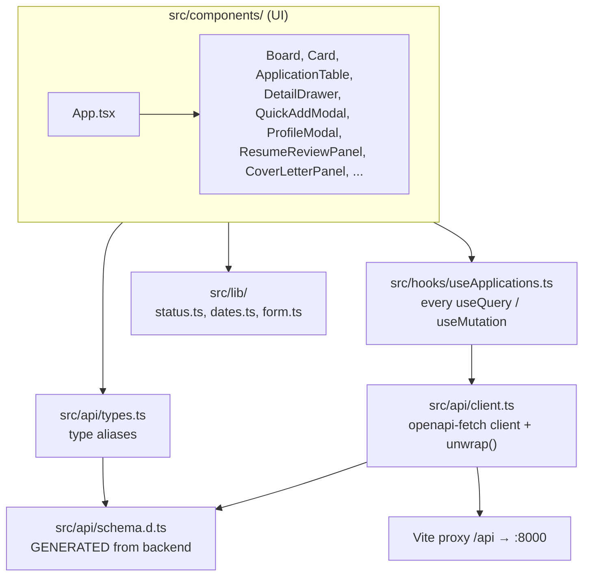
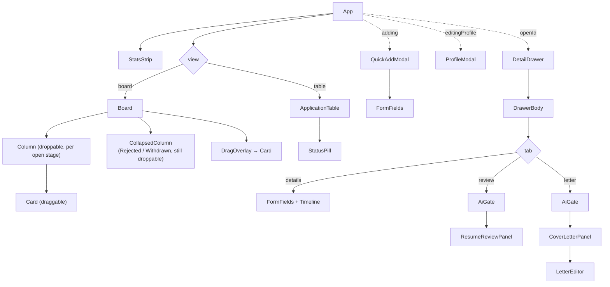
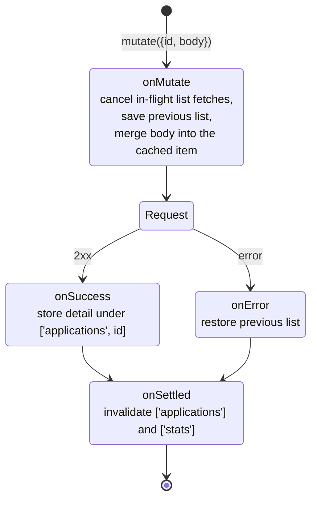
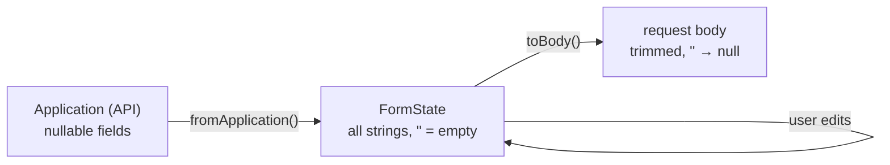

# Frontend guide

React 19 + TypeScript, built with Vite, styled with Tailwind CSS 4. Server data goes through TanStack Query; drag and drop uses dnd-kit. Read [ARCHITECTURE.md](ARCHITECTURE.md) first for the big picture.

## Layers



**The rule:** components never call `api` directly. They call a hook from `useApplications.ts`, and the hook calls `api`. That keeps cache keys and invalidation in one file.

The one exception is file downloads: the `.docx` cover letter and the resume PDF are plain `<a href="/api/...">` links, because the browser handles downloads better than `fetch`.

## Folder by folder

| Path | What's inside |
| ---- | ------------- |
| `main.tsx` | Creates the `QueryClient` (`staleTime: 10s`, `retry: 1`) and renders `<App/>` inside `AuthProvider` and `QueryClientProvider`. `AuthProvider` (`auth/`) shows the app only after login. See `docs/features/03-frontend-login.md`. |
| `App.tsx` | Page shell: header with stats, board/table toggle (remembered in `localStorage`), search box, buttons. Owns which modal/drawer is open. Registers keyboard shortcuts. |
| `api/client.ts` | `api`, the typed `openapi-fetch` client (`baseUrl: ''`, so same-origin `/api/...`). A middleware adds the login token to each request and starts a new login on 401. `unwrap()` turns a result into data or throws an `Error` whose message is the backend's `detail`. |
| `api/schema.d.ts` | Generated by `npm run gen:api`. Never edit by hand. |
| `api/types.ts` | Short names for generated types: `Application`, `ApplicationDetail`, `Status`, `Stats`, `Profile`, `ATSReview`, ... |
| `hooks/useApplications.ts` | All server state. See [Data fetching](#data-fetching-and-the-cache). |
| `lib/status.ts` | Stage order (`OPEN_STATUSES`, `CLOSED_STATUSES`, `STATUSES`), labels and Tailwind colour classes (`STATUS_META`), job type labels. |
| `lib/dates.ts` | `date-fns` helpers: `formatDay`, `ago`, `daysAgo`, `daysUntil`, `todayISO`. |
| `lib/form.ts` | `FormState` (every field as a string), `emptyForm`, `fromApplication` (API → form), `toBody` (form → API, empty strings become `null`). |

## Component tree



| Component | Job |
| --------- | --- |
| `StatsStrip` | Six numbers from `useStats()`. |
| `Board` | dnd-kit `DndContext`. One droppable `Column` per open stage; closed stages are collapsed boxes you can still drop onto. On drop, calls `useUpdateApplication` with the new status. A 6px drag threshold means a plain click still opens the drawer. |
| `Card` | Draggable summary: company, role, type, location, "3 days ago", and a red "Due in N days" warning for wishlist/assessment items with a deadline within a week. |
| `ApplicationTable` | Sortable table, sorted in the browser. Stage sorts in pipeline order; empty values always sort last. |
| `QuickAddModal` | New application. Shows only the essentials until you click "More details". Wishlist items are sent with `applied_at: null`. |
| `DetailDrawer` | Fetches the full application (`useApplication(id)`), then renders `DrawerBody` with `key={data.id}` so the form resets when you open a different application. |
| `DrawerBody` | Stage dropdown in the header (saves immediately), three tabs. The Details form keeps local state and only saves on "Save changes" (disabled until something changed). |
| `Timeline` | Add-a-note form and the event list, newest first, with a coloured dot per stage. |
| `AiGate` | Renders its children only when the profile has a resume **and** the application has a job description; otherwise a checklist with a link to Profile. Mirrors the backend's 400 check. |
| `ResumeReviewPanel` | Run / re-run review, then show score ring, section bars, keyword chips, lists, suggested edits. |
| `CoverLetterPanel` | Optional instructions + Generate. `LetterEditor` is keyed by `generated_at`, so a fresh generation replaces the textarea's content. Edits save on blur. |
| `ProfileModal` | Upload/replace resume (uploads immediately on file pick), edit About me (saved on Save). |
| `FormFields` | Shared inputs for add and edit, plus `Field` and `inputClass`. |

## State: what lives where

| State | Where |
| ----- | ----- |
| Anything from the server (applications, stats, profile, reviews, letters) | TanStack Query cache, via hooks |
| Which view, search text, which modal/drawer is open | `useState` in `App.tsx` |
| Board/table choice across reloads | `localStorage` key `job-tracker:view` |
| Form edits before saving | `useState` in the form component |
| Drag in progress | `useState` in `Board` |

There's no global store (no Redux, no context besides the QueryClient). If you're tempted to add one, check whether the data is really server state first.

## Data fetching and the cache

### Query keys

```
['applications']                     list of all applications       useApplications
['applications', id]                 one application + timeline     useApplication(id)
['applications', id, 'review']       latest resume review or null   useResumeReview(id)
['applications', id, 'cover-letter'] cover letter or null           useCoverLetter(id)
['stats']                            dashboard numbers              useStats
['profile']                          profile                        useProfile
```

The keys are nested on purpose. `invalidateQueries({ queryKey: ['applications'] })` matches by prefix, so it marks the list **and** every detail, review and letter query stale. Active ones refetch in the background.

`useResumeReview` and `useCoverLetter` turn the backend's 404 into `null`, so components can tell "nothing yet" (`null`) from "still loading" (`undefined`).

### What each mutation does to the cache

| Hook | API call | Cache effect |
| ---- | -------- | ------------ |
| `useCreateApplication` | `POST /applications` | invalidate `['applications']` + `['stats']` |
| `useUpdateApplication` | `PATCH /applications/{id}` | **optimistic**: patch the list immediately; on error roll back; on success put the returned detail under `['applications', id]`; always invalidate list + stats |
| `useDeleteApplication` | `DELETE /applications/{id}` | invalidate list + stats |
| `useAddNote` | `POST /applications/{id}/events` | invalidate `['applications', id]` |
| `useUpdateProfile`, `useUploadResume` | `PUT /profile`, `PUT /profile/resume` | write the response into `['profile']` |
| `useRunReview` | `POST .../review` | write the response into the review key |
| `useGenerateCoverLetter`, `useSaveCoverLetter` | `POST` / `PUT .../cover-letter` | write the response into the letter key |

### Optimistic update, step by step



This is why dragging feels instant. It's also why `Board` sets `dropAnimation={null}`: the card has already moved, so animating it back to where it came from would look wrong.

## Typed API calls

```ts
// in a hook
const result = await api.PATCH('/api/applications/{application_id}', {
  params: { path: { application_id: id } },
  body,                                  // typed as ApplicationUpdate
})
return unwrap(result)                    // typed as ApplicationDetail, or throws
```

The path string, `params` and `body` are all checked against `schema.d.ts`. If the backend renames a field, `npm run gen:api` followed by `npm run build` shows every place that needs updating.

The resume upload is the one awkward case: the generated type says the `file` field is a `string`, but it must be sent as multipart. `useUploadResume` casts the body and passes a `bodySerializer` that builds `FormData`.

## Forms



HTML inputs want strings, the API wants `null` for "not set". `lib/form.ts` converts both ways so components don't have to. To add a field: add it to `FormState`, `emptyForm`, `fromApplication`, `toBody`, and render it in `FormFields.tsx`.

## Keyboard shortcuts

Registered once in `App.tsx`:

| Key | Action | Notes |
| --- | ------ | ----- |
| `N` | open Add application | ignored while typing in an input |
| `/` | focus search | ignored while typing in an input |
| `Esc` | close any modal or drawer | always |

## Styling

- Tailwind utilities directly in `className`; no CSS modules or component library.
- Neutral colours come from the `stone` palette.
- Stage colours are defined once in `lib/status.ts` (`STATUS_META[status].dot` / `.pill`). Use those instead of hard-coding colours for a stage.

## TypeScript settings that bite

`tsconfig` turns on `erasableSyntaxOnly` and `verbatimModuleSyntax`:

- No TypeScript `enum`. Use string unions (the generated `Status` type already is one) and `as const` arrays.
- Import types with `import type { ... }`, otherwise the build fails.

## Commands

```bash
npm run dev       # Vite on :5173, proxies /api to :8000 (backend must be running)
npm run build     # tsc -b (type check) + production build
npm run lint      # oxlint
npm run gen:api   # regenerate src/api/schema.d.ts from the backend
```

## Gotchas

- "Couldn't reach the API" on the page means the backend isn't running on port 8000 (or Postgres isn't up, so the backend errors).
- Search filters the already-loaded list in the browser (company, role, location, notes). The backend's `q` parameter exists but isn't used by the UI.
- AI calls can take up to a minute; the panels show a pending message while `isPending` is true.
- The cover letter saves on **blur**. Closing the drawer with `Esc` while the textarea is focused can lose the last edit.
