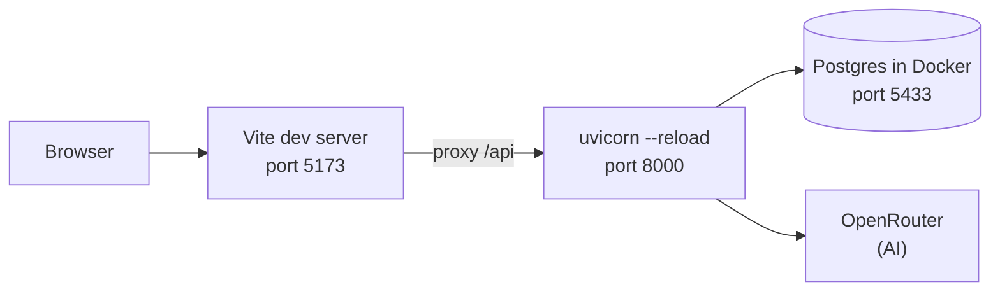
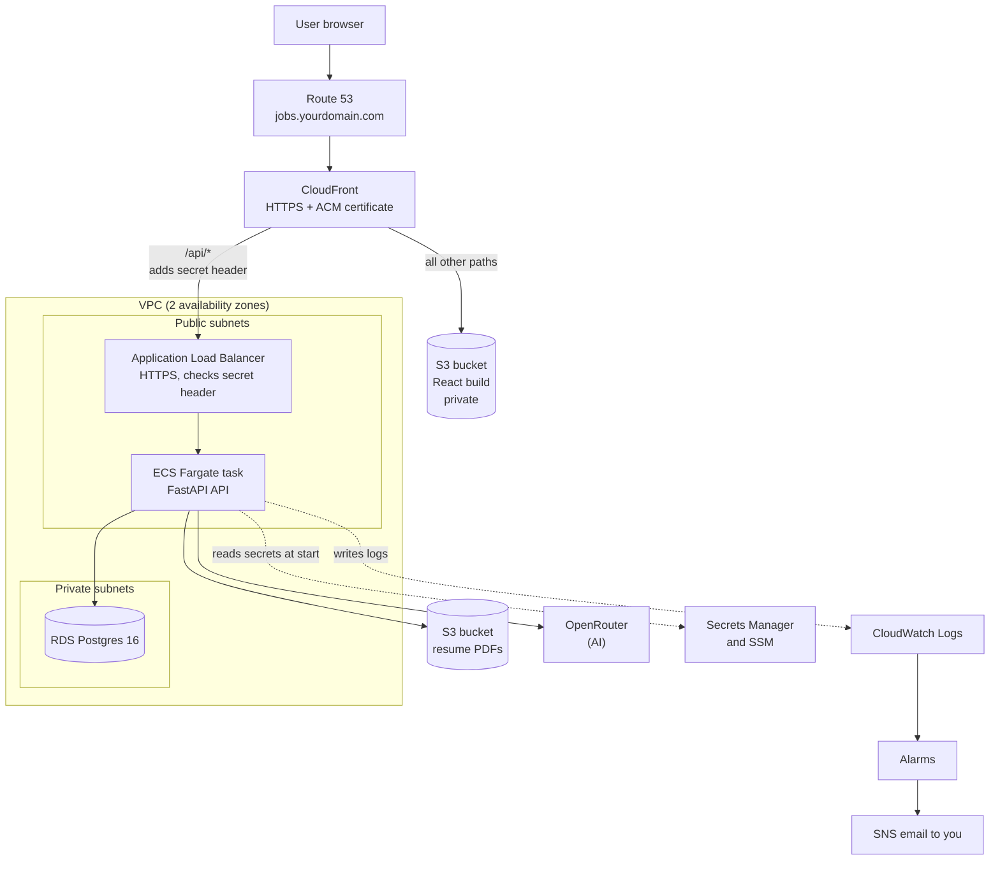
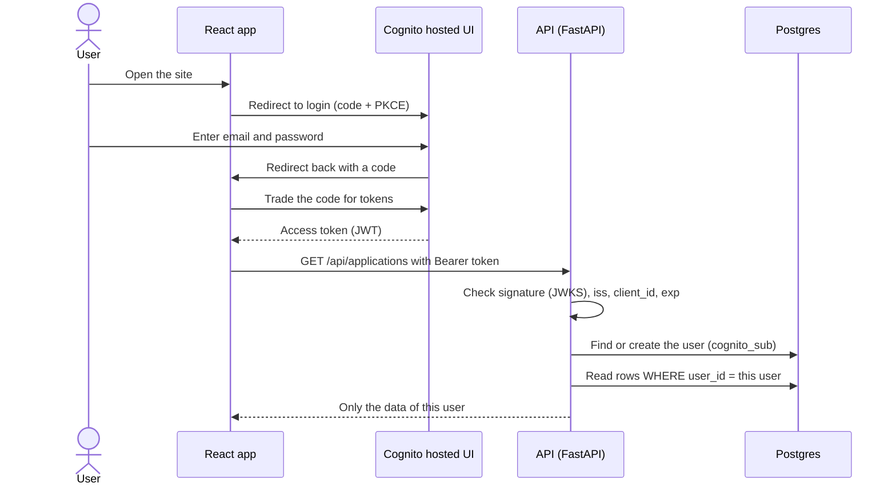

# Implementation guide: put Job Tracker on AWS

This guide tells you **how** to do the work. `docs/DEPLOYMENT_PLAN_AWS.md` tells you **what** to build and **why**. Read the plan when you need the reason for a step.

This guide uses ASD-STE100 Simplified Technical English. Each step is one action.

## 1. Short answer: what is missing?

You asked if login, sign-up and logging are missing. **Yes, you are right.** I looked at the code. This is what I found.

### 1.1 Blockers (do these before another person uses the app)

| # | Missing part | What I found in the code |
|---|---|---|
| 1 | **Users and login** | `backend/app` and `frontend/src` have no auth code. There is no `users` table. Each route returns all rows to any person who opens the URL. |
| 2 | **Sign-up** | Not present. Decision: **invite-only**. You create each user in Cognito. There is no public sign-up page. |
| 3 | **Data for each user** | `applications`, `resume_reviews` and `cover_letters` have no `user_id`. `Profile` is one row for the whole app. |
| 4 | **Logging** | The app has no `logging` setup. Only uvicorn writes a line for each request. |
| 5 | **Real health check** | `/api/health` always returns `{"status":"ok"}`. It does not test the database. It does not show the version. |
| 6 | **Container image** | No `backend/Dockerfile`. No `backend/.dockerignore`. No `docker-compose.prod.yml`. |
| 7 | **Production settings** | `backend/app/config.py` has no Cognito settings, no environment name and no git SHA. |
| 8 | **Infrastructure** | There is no `infra/` folder (Terraform). |

### 1.2 Needed soon (before you invite other persons)

| # | Missing part | Why |
|---|---|---|
| 9 | **Daily AI limit for each user** | Each AI request costs money. Without a limit, one user can use all your OpenRouter credit. |
| 10 | **Deploy workflow** | Only `ci.yml` exists. You can deploy by hand at first, but the workflow is safer. |

### 1.3 Already good (do not change)

- CI in `.github/workflows/ci.yml`.
- Alembic migrations and `alembic check`.
- The frontend uses relative `/api` URLs (`frontend/src/api/client.ts`). This works with CloudFront.
- Settings come from the environment (`backend/app/config.py`).

## 2. Diagrams

The diagrams are in Mermaid. GitHub shows them as pictures. To see them in VS Code, install the extension "Markdown Preview Mermaid Support".

### 2.1 Today (your laptop)



There is no login. Anyone who reaches port 8000 sees all data.

### 2.2 Target: how a request moves



Read the diagram like this:

1. The user opens your domain. Route 53 sends the request to CloudFront.
2. CloudFront sends `/api/*` to the load balancer. It sends all other paths to the S3 bucket with the React files.
3. The load balancer sends the request to the API task.
4. The API reads and writes data in RDS. RDS has no public address.

### 2.3 Login (invite-only)



### 2.4 Deployment pipeline

```mermaid
flowchart LR
    G["git push to main"] --> CI["CI jobs pass<br/>(ci.yml)"]
    CI --> OIDC["Log in to AWS<br/>with OIDC"]
    OIDC --> IMG["Build image<br/>push to ECR as SHA"]
    IMG --> MIG["Migrate: ECS run-task<br/>alembic upgrade head"]
    MIG --> DEP["Deploy: ECS service<br/>circuit breaker on"]
    DEP --> FE["Frontend: npm run build<br/>S3 sync"]
    FE --> INV["CloudFront invalidation<br/>/index.html"]
    INV --> SMK["Smoke test<br/>/api/health shows new SHA"]
```



## 3. The route in one list

Do the steps in this order. Each step has a "Done when" check. Do not go to the next step until the check passes.

| Step | What | Where | Needed to use the app on AWS? |
|---|---|---|---|
| 0 | AWS account safety and budget | AWS console | **Yes** |
| 1 | Users and login | Code | **Yes** |
| 2 | Logging and health check | Code | **Yes** |
| 3 | Daily AI limit | Code | Yes, before you invite others |
| 4 | Container image | Code | **Yes** |
| 5 | Terraform infrastructure | `infra/` | **Yes** |
| 6 | Deploy workflow | GitHub Actions | No (you can deploy by hand first) |
| 7 | First deploy and invite users | AWS + terminal | **Yes** |
| 8 | Operate: backups, alarms, runbook | AWS | No, but do it in the first month |

**Minimum path if only you use the app:** Steps 0, 1, 2, 4, 5, 7.

## 4. Step 0: AWS account safety and budget

**Goal:** Your AWS account is safe and cannot make a surprise bill.

Follow Phase 0 in `DEPLOYMENT_PLAN_AWS.md`. These are the actions:

1. Sign in as the root user. Turn on MFA.
2. Open **IAM Identity Center**. Turn it on.
3. Create an admin user for yourself. Give it the `AdministratorAccess` permission set.
4. Stop using the root user.
5. On your laptop, run `aws configure sso`. Follow the prompts.
6. Open **Billing** → **Budgets**. Create a monthly cost budget (for example $30). Add email alerts at 50%, 80% and 100%.
7. Turn on **Cost Explorer**.
8. Select the region. Use **eu-central-1** unless you checked that **me-central-1** has all the services.
9. Register your domain in Route 53, or move its DNS to Route 53.

**Done when:**

- `aws sts get-caller-identity` shows your admin user (not root).
- The budget exists and sends a test email.

## 5. Step 1: Users and login (blocker)

**Goal:** Each user sees only their own data.

This step has five parts. Do them in this order.

### 5.1 Database

Files: `backend/app/models.py`, new file in `backend/alembic/versions/`.

1. Add a `User` model with the table name `users`. Columns: `id` (UUID), `cognito_sub` (text, unique), `email` (text), `created_at`.
2. Add a `user_id` column to `Application`, `Profile`, `ResumeReview` and `CoverLetter`. Make it a foreign key to `users.id` with an index.
3. Change `Profile`. It must have one row for each user. Remove the fixed `id = 1` rule. Add a unique constraint on `user_id`.
4. Create the migration:

   ```
   cd backend
   uv run alembic revision --autogenerate -m "add users and user_id"
   ```

5. Open the new migration file. Edit it by hand so that it:
   1. Creates `users`.
   2. Adds `user_id` as **nullable**.
   3. Inserts one user for you (use your Cognito `sub` later, or a placeholder).
   4. Sets `user_id` on all current rows to that user.
   5. Changes `user_id` to **not null**.
6. Run `uv run alembic upgrade head` and `uv run alembic check`.

**Note:** Use the expand/contract rule from the plan. The old code must still work with the new tables if you roll back.

### 5.2 Backend: check the token

Files: new `backend/app/auth.py`, `backend/app/config.py`.

1. In `config.py`, add: `environment`, `cognito_region`, `cognito_user_pool_id`, `cognito_app_client_id`, `auth_disabled`, `git_sha`.
2. In `auth.py`, write a `current_user` dependency. It must do these things:
   1. Read the `Authorization: Bearer <token>` header. If it is missing, return 401.
   2. Download the JWKS from `https://cognito-idp.<region>.amazonaws.com/<pool_id>/.well-known/jwks.json`. Keep it in a cache.
   3. Check the signature. Check `iss`, `token_use` (`access`), `client_id` and `exp`.
   4. Find the row in `users` with `cognito_sub = token["sub"]`. If there is none, add it.
   5. Return the `User`.
3. Add a package for JWT checks, for example `uv add pyjwt[crypto]`.
4. Add the dev bypass. If `auth_disabled` is true, `current_user` returns one fixed dev user. Put `AUTH_DISABLED=true` in `backend/.env` so `task dev` works as before.
5. Make `auth_disabled` fail safe. If `environment` is `production` and `auth_disabled` is true, the app must refuse to start.

The signature of the dependency:

```python
async def current_user(
    authorization: str | None = Header(default=None),
    session: AsyncSession = Depends(get_session),
) -> User: ...
```

### 5.3 Backend: filter by user

Files: `backend/app/routers/applications.py`, `stats.py`, `profile.py`, `ai.py`.

1. Add `user: User = Depends(current_user)` to each route.
2. In each query, add `.where(Model.user_id == user.id)`.
3. When you create a row, set `user_id=user.id`.
4. When a row belongs to another user, return **404** (not 403). Then users cannot find out that an id exists.
5. In `profile.py`, find the profile by `user_id`. Create it if it does not exist.
6. In `stats.py`, count only the rows of the user.
7. Add `DELETE /api/me`. It deletes the user. The database deletes all their rows (`ondelete="CASCADE"` on `user_id`).

### 5.4 Tests

Files: `backend/tests/conftest.py`, new `backend/tests/test_isolation.py`.

1. In `conftest.py`, add two users, A and B.
2. Override `current_user` with a fixture. The fixture lets a test choose A or B.
3. Write tests. User B must get **404** for these things of user A:
   - an application (GET, PATCH, DELETE)
   - the profile
   - a resume review and a cover letter
4. Write a test that a list route returns only the rows of the user.
5. Write a test for `DELETE /api/me`.
6. Run `uv run pytest`.

### 5.5 Frontend

Files: `frontend/src/api/client.ts`, `frontend/src/main.tsx`, `frontend/src/App.tsx`.

1. Install the library: `npm install oidc-client-ts`.
2. Create a small auth module (for example `src/auth/auth.ts`). Set it up with:
   - `authority`: `https://cognito-idp.<region>.amazonaws.com/<pool_id>`
   - `client_id`: the Cognito app client id
   - `redirect_uri`: `<site>/auth/callback`
   - `response_type`: `code` (PKCE is on by default)
   - `scope`: `openid email`
3. Read these values from `VITE_` environment variables. Put the production values in the build step of the deploy.
4. In `client.ts`, add a middleware to `openapi-fetch`. It adds `Authorization: Bearer <access_token>` to each request.
5. In `main.tsx`, if the user is not logged in, redirect to the Cognito hosted UI. Handle the `/auth/callback` route.
6. In `App.tsx`, add a **Log out** button and show the user email.
7. Add a dev bypass: if `VITE_AUTH_DISABLED=true`, do not redirect and do not add the header.
8. Run:

   ```
   cd frontend
   npm run gen:api
   npm run lint
   npm run build
   ```

**Note:** Do not edit `schema.d.ts` by hand.

**Done when:**

- `uv run pytest` passes, including the isolation tests.
- `task dev` still works with `AUTH_DISABLED=true`.
- `npm run build` passes.

You test the real Cognito login in Step 7, after Terraform creates the user pool.

## 6. Step 2: Logging and health check (blocker)

**Goal:** You can find out what happened when something fails. The health check tells the truth.

Files: `backend/app/main.py`, new `backend/app/logging_config.py`.

1. Write `logging_config.py`. It sets up Python `logging` to write **JSON lines to stdout**. Each line has: time, level, message, `request_id`, `user_id` (if known), path, status and duration.
2. In `main.py`, add a middleware. It does these things:
   1. Makes a `request_id` (or reads `X-Request-Id`).
   2. Measures the time of the request.
   3. Writes one log line when the request ends.
   4. Adds `X-Request-Id` to the response.
3. Log these events with `logger.info` or `logger.warning`:
   - a login that fails (401)
   - a user is created
   - an AI request starts and ends (with duration and model, **not** the resume text)
   - an exception (use `logger.exception`)
4. **Do not log:** tokens, resume text, about-me text, or the OpenRouter key.
5. Change `/api/health`:
   1. Run `SELECT 1` on the database.
   2. If it works, return `{"status":"ok","version":"<git_sha>"}`.
   3. If it fails, return status 503.
6. Keep `/api/health` open (no login). The load balancer and the smoke test use it.

On AWS, the ECS `awslogs` driver sends stdout to CloudWatch Logs. You do not need a log file.

**Done when:**

- You run the API and see one JSON line for each request.
- `curl localhost:8000/api/health` shows `version`.
- Stop Postgres. `/api/health` returns 503.

## 7. Step 3: Daily AI limit

**Goal:** One user cannot use all your OpenRouter credit.

Files: `backend/app/models.py`, new migration, `backend/app/routers/ai.py`, `backend/app/config.py`.

1. Add a table `ai_usage` with: `user_id`, `day` (date), `count`. Make `(user_id, day)` unique.
2. Add a setting `ai_daily_limit` (for example 20).
3. In each AI route, before you call the model:
   1. Read the count of the user for today.
   2. If the count is at the limit, return **429** with a short message.
   3. If not, add 1 and continue.
4. Write a test: the request number `limit + 1` returns 429. Use the fake LLM from `tests/test_ai.py`.
5. In OpenRouter, make a **separate key for production**. Set a credit limit on it.

**Done when:** the test passes and the production key has a limit.

## 8. Step 4: Container image

**Goal:** The production build runs on your laptop in Docker, the same way as on AWS.

### 8.1 Dockerfile

File: `backend/Dockerfile`.

1. Stage 1 (`builder`): use a Python image with `uv`. Copy `pyproject.toml` and `uv.lock`. Run `uv sync --locked --no-dev`.
2. Stage 2 (`runtime`): use a small Python image. Copy the virtual environment and the `app/` folder. Copy `alembic/` and `alembic.ini` (the migration task needs them).
3. Make a user that is not root. Run the app as that user.
4. Add `ARG GIT_SHA` and `ENV GIT_SHA=$GIT_SHA`. The health check reads it.
5. Use this command:

   ```
   CMD ["uvicorn","app.main:app","--host","0.0.0.0","--port","8000","--workers","2","--proxy-headers","--forwarded-allow-ips=*"]
   ```

6. Create `backend/.dockerignore`. Add: `.venv`, `.env`, `__pycache__`, `tests`, `.pytest_cache`.

**Note:** Never copy `.env` into the image.

### 8.2 Local production test

File: `docker-compose.prod.yml`.

1. Add three services:
   - `db`: Postgres 16 (same as `docker-compose.yml`).
   - `api`: build from `backend/`. Set `DATABASE_URL`, `ENVIRONMENT=production`, `AUTH_DISABLED=true` for this local test only.

     **Warning:** Step 1 makes the app refuse to start with `ENVIRONMENT=production` and `AUTH_DISABLED=true`. For this local test, use `ENVIRONMENT=staging`.
   - `web`: nginx or caddy. Serve `frontend/dist`. Send `/api` to `api:8000`.
2. Run:

   ```
   cd frontend && npm run build
   cd .. && docker compose -f docker-compose.prod.yml up --build
   ```

3. Run the migrations inside the `api` container: `alembic upgrade head`.

**Done when:**

- The app opens on your laptop through the `web` service.
- `/api/health` shows the database status and the version.
- You can add an application and see it.

## 9. Step 5: Terraform infrastructure

**Goal:** All AWS resources are in code. You can create and remove them with a command.

Follow Phase 3 in `DEPLOYMENT_PLAN_AWS.md`. Here is how to work.

### 9.1 Rules

1. Install Terraform. Run `terraform version`.
2. Put the files in `infra/`. Make a folder `infra/bootstrap/` for the first part.
3. After **each** file, run `terraform plan`, read it, then run `terraform apply`.
4. Add `*.tfstate`, `.terraform/` and `*.tfvars` (with secrets) to `.gitignore`.
5. Write `docs/DEPLOYMENT_AWS.md` while you work. For each resource, write what it does and its cost.

### 9.2 Order of the files

| # | File | You get | Check |
|---|---|---|---|
| 1 | `infra/bootstrap/` | State bucket, GitHub OIDC provider, deploy role | `terraform init` in `infra/` uses the S3 backend |
| 2 | `network.tf` | VPC, subnets, internet gateway, security groups | VPC shows in the console |
| 3 | `database.tf` | RDS Postgres, subnet group, `rds.force_ssl=1` | Status is "Available" |
| 4 | `ecr.tf`, `ecs.tf` | Image repository, cluster, task definition, service, roles | Service exists (it fails to start until you push an image) |
| 5 | `alb.tf` | Load balancer, HTTPS listener, target group `/api/health` | DNS name of the ALB answers with 403 (no secret header) |
| 6 | `frontend.tf` | S3 bucket, CloudFront, certificate (us-east-1), Route 53 record | Your domain shows an error page from S3 (no files yet) |
| 7 | `auth.tf` | Cognito user pool, app client, hosted UI domain | Hosted UI login page opens |
| 8 | `monitoring.tf` | Log retention, SNS email, alarms, health check | You get the SNS confirmation email. Click the link. |

### 9.3 Important settings (do not forget)

- Cognito: `allow_admin_create_user_only = true` (this is how invite-only works).
- Cognito callback URLs: `https://jobs.yourdomain.com/auth/callback` and `http://localhost:5173/auth/callback`.
- RDS: `manage_master_user_password = true`, `publicly_accessible = false`, backup retention 7 days.
- ECS task: put the RDS secret and the OpenRouter key in `secrets` (not in `environment`).
- ECS task: set `COGNITO_USER_POOL_ID`, `COGNITO_APP_CLIENT_ID`, `COGNITO_REGION`, `ENVIRONMENT=production` and `AUTH_DISABLED=false`.
- ECS service: turn on the deployment circuit breaker with rollback.
- CloudFront `/api/*`: no cache, forward all headers, origin response timeout 60 seconds.

**Done when:**

- `terraform plan` shows no changes.
- `psql` from your laptop to the RDS address fails (it is private).

## 10. Step 6: Deploy workflow

**Goal:** A push to `main` deploys the app.

File: `.github/workflows/deploy.yml`. Follow Phase 4 in the plan.

1. Start the workflow after `ci.yml` passes on `main`.
2. Give the job `permissions: id-token: write` and `contents: read`.
3. Use `aws-actions/configure-aws-credentials` with `role-to-assume` (the role from Step 5).
4. Store non-secret values as GitHub repository **variables** (region, ECR name, cluster, service, bucket, distribution id). You need no AWS keys.
5. Add the jobs in this order: build and push → migrate → deploy → frontend → smoke test.
6. In the build, pass `--build-arg GIT_SHA=<sha>`.
7. In the frontend build, set the `VITE_` values for Cognito.
8. Add `task deploy`, `task rollback`, `task logs` and `task infra:plan` to `Taskfile.yml`.

**Done when:** a small change on `main` goes live, and `/api/health` shows the new SHA.

## 11. Step 7: First deploy and invite users

**Goal:** The app runs on your domain and you can log in.

1. Push the first image to ECR (by hand or with the workflow). Use the SHA as the tag.
2. Run the migration task: `aws ecs run-task` with the command `alembic upgrade head`. Wait for exit code 0.
3. Update the ECS service to use the image. Wait until it is stable.
4. Build the frontend. Run `aws s3 sync frontend/dist s3://<bucket>`. Create a CloudFront invalidation for `/index.html`.
5. Open `https://jobs.yourdomain.com/api/health`. Check that it shows the right SHA.
6. **Invite yourself:**

   ```
   aws cognito-idp admin-create-user \
     --user-pool-id <pool_id> \
     --username you@example.com \
     --user-attributes Name=email,Value=you@example.com Name=email_verified,Value=true
   ```

7. Cognito sends an email with a temporary password.
8. Open the site. Log in with the temporary password. Cognito asks you to set a new password.
9. Move your old data to your account. In the database, set the placeholder user from the migration to your real `cognito_sub`. (If you start with empty data, skip this.)
10. Invite a second test user. Log in as that user. Make sure that the user sees none of your data.

**Done when:** two users log in and each sees only their own data.

## 12. Step 8: Operate

Follow Phase 5 in the plan. These are the first actions:

1. Make sure that you get the SNS alarm emails. Test: set the ECS desired count to 0. Wait for the alarm. Set it back to 1.
2. Do a point-in-time restore of RDS to a new instance. Count the rows. Delete the new instance.
3. Do one rollback on purpose: `aws ecs update-service --task-definition jobtracker-api:<n>`.
4. Deploy a broken image on purpose. Make sure that the circuit breaker goes back to the last version.
5. Turn on Dependabot for pip, npm and GitHub Actions.
6. Write the runbook in `docs/DEPLOYMENT_AWS.md`: deploy, roll back, restore, change a secret, read logs, invite a user, remove everything.

### 12.1 Useful commands

| Task | Command |
|---|---|
| Read logs | `aws logs tail /ecs/jobtracker-api --follow` |
| Invite a user | `aws cognito-idp admin-create-user ...` (see Step 7) |
| Remove a user | `aws cognito-idp admin-delete-user --user-pool-id <id> --username <email>` |
| Make a DB snapshot | `aws rds create-db-snapshot --db-instance-identifier <id> --db-snapshot-identifier <name>` |
| See infra changes | `terraform plan` |
| Remove all resources | `terraform destroy` |

**Note:** `admin-delete-user` removes the login only. Call `DELETE /api/me` first to remove the data of the user.

## 13. Common problems

| Problem | Likely cause | What to do |
|---|---|---|
| The ECS task stops at start | Missing secret or wrong `DATABASE_URL` | Read the logs: `aws logs tail ... --follow` |
| Target group shows "unhealthy" | The health check fails, or the task security group blocks the ALB | Check `/api/health` and the security groups |
| `/api` returns 403 from the ALB | The secret header is wrong | Make sure CloudFront and the ALB rule use the same value |
| The site shows a blank page after a deploy | The browser keeps the old `index.html` | Invalidate `/index.html` in CloudFront |
| The login loops | The callback URL is not in the Cognito app client | Add the URL in `auth.tf` and apply |
| 401 on each API call | `iss`, `client_id` or region is wrong in the task settings | Compare the task settings with the Cognito pool |
| AI request times out | CloudFront waits only 60 seconds | Use a shorter prompt, or do Phase 6 (async AI) |
| Migration task fails | The migration has an error | The workflow stops. Fix the migration. The old version continues to run. |

## 14. Final check list

Copy this list. Mark each line when it is done.

- [ ] Step 0: MFA, SSO, budget, region, domain
- [ ] Step 1: users table, `current_user`, filters, isolation tests, frontend login
- [ ] Step 2: JSON logs, DB health check with version
- [ ] Step 3: daily AI limit, separate production key
- [ ] Step 4: Dockerfile, `.dockerignore`, `docker-compose.prod.yml` test
- [ ] Step 5: all Terraform files applied, `terraform plan` shows no changes
- [ ] Step 6: `deploy.yml` works
- [ ] Step 7: first deploy, two test users, data is separate
- [ ] Step 8: alarm test, restore test, rollback test, runbook
