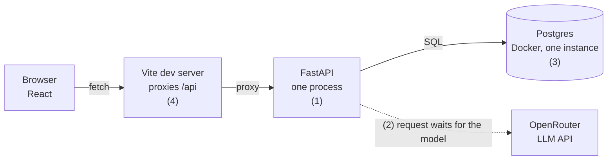
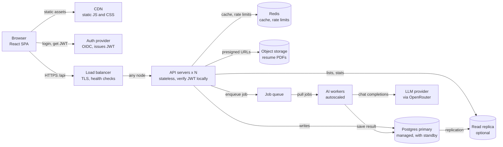
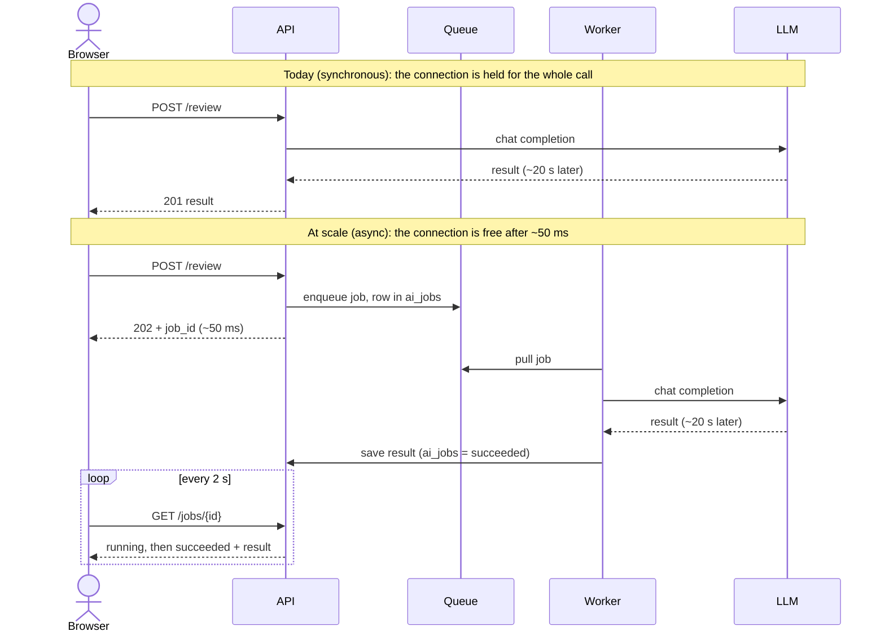
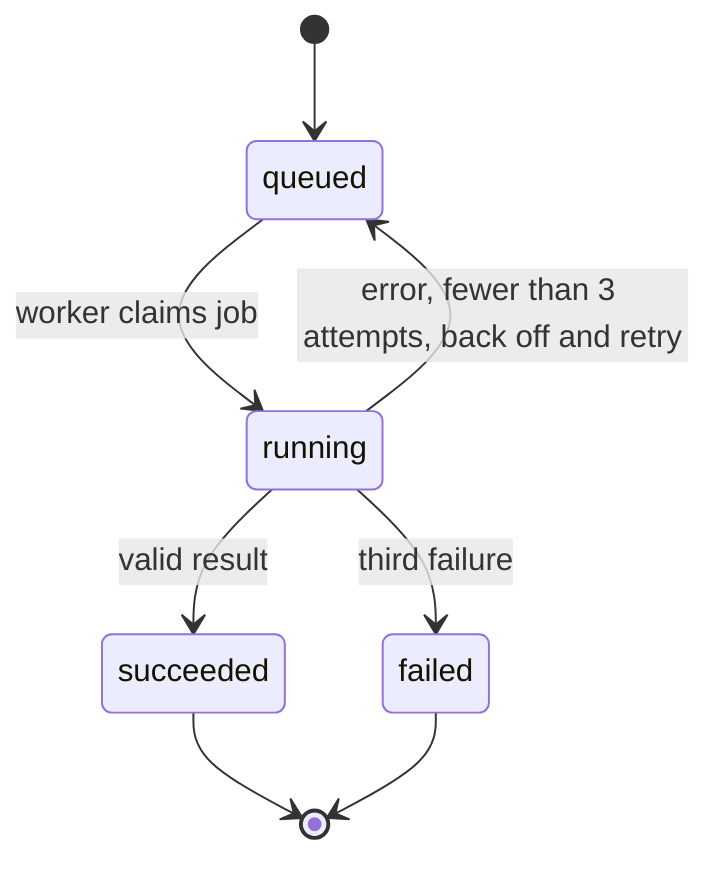

# System design: Job Tracker at scale

A hypothetical scale-up of Job Tracker from one user to 100,000 daily users, worked through the six-step system design framework. This is a design exercise, not a description of the code. All numbers are assumptions. For how the app works today, see [ARCHITECTURE.md](ARCHITECTURE.md).

The six steps (books label them slightly differently): clarify requirements, estimate load, define API and data model, draw the high-level design, deep dive on the risky parts, then name bottlenecks and trade-offs. In a 45 minute interview, spend roughly 5, 5, 5, 10, 15 and 5 minutes on them.

## Step 1: Clarify requirements and scope

> "Before I draw anything, let me pin down what we are building and for how many people."

**Functional (in scope)**

- Sign up, log in, and see only your own data
- Create, edit and delete applications; move them between stages
- Timeline of status changes and notes per application
- Stats: interviews and response rate, from event history
- Upload a resume and an "about me" note
- AI resume review and cover letter for an application

**Non-functional targets**

- **Availability:** 99.9% for the API (about 9 hours of downtime a year)
- **Latency:** p95 under 300 ms for normal reads and writes
- **AI:** may take up to 30 s, but must never freeze the UI
- **Privacy:** resumes are personal data; users must be able to delete everything
- **Isolation:** no user can ever read another user's rows
- **Cost:** LLM calls must be capped per user

**Questions to ask, and the answers assumed**

- How many users? 500,000 registered, 100,000 active per day.
- Web only? Web first. The API should be clean enough for a mobile app later.
- Teams, sharing, recruiters? Out of scope. Every record belongs to exactly one user.
- Is the AI feature central? It is a headline feature, and also the most expensive and slowest thing in the system.
- Real-time sync across devices? No. A refresh within a few seconds is fine.

## Step 2: Estimate the load

> "A few quick numbers tell me which parts need real engineering and which do not."

| What             | Assumption                                    | Result                  | Peak (10x average)                    |
| ---------------- | --------------------------------------------- | ----------------------- | ------------------------------------- |
| Reads            | 100k DAU x 20 reads/day = 2M/day              | 2M / 86,400 = ~23 req/s | ~230 req/s                            |
| Writes           | 100k DAU x 3 writes/day = 300k/day            | ~3.5 req/s              | ~35 req/s                             |
| AI calls         | 10% of DAU, once a day = 10k/day              | ~0.12 req/s             | ~1.2 req/s, ~25 in flight at 20 s each |
| Application data | 500k users x 50 apps x ~3 KB (row + events)   | ~75 GB                  | grows slowly                          |
| Resume files     | 500k users x ~0.5 MB                          | ~250 GB                 | larger than all other data combined   |
| LLM spend        | 10k calls/day x ~$0.03 (assumed price)        | ~$300/day               | ~$9k/month, the largest bill          |

**What the numbers say.** 230 requests per second of simple, indexed queries is small; one well-tuned Postgres primary can handle that. The hard parts are not raw throughput. They are a slow and costly external call (AI), large files in the database, isolating users from each other, and staying up when one piece fails. The design spends its effort there.

## Step 3: Define the API and the data model

> "I will keep the REST API we already have, add auth and versioning, and change only the endpoints that behave differently at scale."

| Endpoint                                | Notes                                                                                                                                                        |
| --------------------------------------- | ------------------------------------------------------------------------------------------------------------------------------------------------------------ |
| `GET /v1/applications?cursor=&limit=`   | Scoped to the logged-in user. Cursor pagination even though one user has few rows, so the contract does not break later.                                     |
| `PATCH /v1/applications/{id}`           | Sends `If-Match: version`. Returns 409 if another device changed the row first. Still writes a `StatusEvent` in the same transaction.                        |
| `GET /v1/stats`                         | Computed from the event history, cached briefly (see deep dive C).                                                                                           |
| `POST /v1/profile/resume-upload-url`    | Returns a short-lived presigned URL. The browser uploads the PDF straight to object storage, so file bytes never pass through the API.                       |
| `POST /v1/applications/{id}/review`     | **Changed.** Returns `202 Accepted` with a `job_id` instead of waiting for the model. Same for the cover letter.                                              |
| `GET /v1/jobs/{id}`                     | **New.** Status of an AI job: queued, running, succeeded, failed. Result included when done.                                                                 |

**Data model: what changes from today**

| Table                          | Today                                     | At scale                                                                                          | Why                                                                              |
| ------------------------------ | ----------------------------------------- | ------------------------------------------------------------------------------------------------- | -------------------------------------------------------------------------------- |
| `users`                        | does not exist                            | `id`, `auth_sub`, `email`, `created_at`                                                           | Identity comes from the auth provider; we store only a reference to it.          |
| `applications`                 | no owner                                  | adds `user_id` (FK), `version`; index on `(user_id, status)`                                      | Every query filters by owner. The version number detects conflicting edits.      |
| `status_events`                | by application                            | index on `(application_id, created_at)`, keeps cascade delete                                     | Same replay logic for stats; still deleted with the application.                 |
| `profile`                      | one row, `id = 1`, PDF stored as bytes    | keyed by `user_id`; `resume_key`, `size`, `sha256`                                                | 250 GB of PDFs should not sit in the database that backs every query.            |
| `ai_jobs`                      | does not exist                            | `id`, `user_id`, `application_id`, `kind`, `status`, `attempts`, `result`, `error`                | The durable record of AI work, independent of the queue.                         |
| `resume_reviews`, `cover_letters` | per application                        | add `user_id`                                                                                     | Lets us enforce isolation and delete a user's data in one pass.                  |

## Step 4: Draw the high-level design

> "I will start from what exists, mark what will break, and then add only the pieces that fix those."

### Figure 1: the system as built

Four things stop it from serving many users:

1. **No users.** There is one `Profile` row and nothing is owned by anyone, so data from two people would mix.
2. **The review request is held open.** The endpoint keeps the HTTP request open for the whole model call, 10 to 30 seconds. Many slow requests tie up API workers.
3. **Resume bytes in Postgres.** Fine for one file, costly for 250 GB, and it slows backups.
4. **One of everything.** One API process and one database instance. Anything that fails takes the whole app down, and the Vite proxy only exists in development.

### Figure 2: the scaled design

New compared with today: CDN, load balancer, auth provider, Redis, read replica, object storage, queue and workers. The API servers hold no state, so any of them can answer any request. The slow AI path no longer goes through the API; it goes through the queue and the workers (workers also read the resume PDF from object storage).

**What each addition buys, and what it costs**

| Addition                           | It solves                                                                     | It costs                                                                                      |
| ---------------------------------- | ----------------------------------------------------------------------------- | --------------------------------------------------------------------------------------------- |
| Load balancer + N stateless APIs   | Issue 4. A node can die or be redeployed without downtime; capacity grows by adding nodes. | Nothing may live in a server's memory or disk. Sessions must be tokens or in a shared store.  |
| Auth provider + `user_id`          | Issue 1. Real accounts, and every query is scoped to the caller.              | A dependency on an outside service. A missed `user_id` filter becomes a data leak (deep dive B). |
| Object storage                     | Issue 3. Cheap, durable file storage, with direct browser uploads.            | Two systems must stay in sync: a DB row can point to a missing file.                          |
| Queue + workers                    | Issue 2. AI work moves off the request path and can be rate limited and retried. | More moving parts, and the UI has to poll for results.                                     |
| Redis                              | Per-user AI quotas and a short cache for stats.                               | Another service to run. Treated as disposable: losing it must not lose data.                  |
| CDN                                | Static files served near the user without touching our servers.               | Cache invalidation on deploy (hashed filenames make this easy).                               |

## Step 5: Deep dive on the risky parts

> "I will pick the parts where a wrong decision is expensive: the AI path, tenancy, and what happens when two devices write at once."

### A. The AI path: from a held connection to a job

The model call takes the same time either way. What changes is who waits: the API connection is held for about 20 s in the synchronous version, and for about 50 ms in the async one.

Job lifecycle. The state lives in the `ai_jobs` table, not in the queue, so a lost queue message can be re-created from the table.

- **Idempotency.** A unique rule on (user, application, kind) while a job is queued or running means a double-click returns the existing job instead of paying for two calls.
- **Cost control.** A per-user daily quota in Redis (for example 20 calls), plus a global monthly budget that pauses the queue if exceeded. At about $300/day this is the cheapest reliability feature we can build.
- **Provider outages.** Jobs wait in the queue and retry. OpenRouter lets us fall back to a second model by changing the model name.
- **Polling vs push.** Poll every 2 s. Server-sent events would feel smoother but need long-lived connections through the load balancer. At about 25 jobs in flight, polling costs almost nothing.
- **Prompt stability.** The prompt stays byte-identical between calls so the provider's prompt caching keeps working, as in the current `prompts.py`.

### B. Tenancy and auth: the bug that must be impossible

The worst failure in a multi-user app is showing one person another person's resume. Two layers guard against it. First, one FastAPI dependency (`current_user`) reads the verified token, and every query helper takes the user id as a required argument, so forgetting the filter does not pass review. Second, Postgres row-level security as a safety net, with the user id set per transaction.

**Trade-off.** Row-level security catches mistakes in application code, but it adds setup, needs care with connection pooling, and makes queries harder to debug. Add it before storing other people's resumes, not after. For login, use a hosted provider instead of storing passwords ourselves. It costs money and a dependency, and removes a whole class of security work. The API verifies a short-lived JWT (about 15 minutes) with the provider's public key, so no database call is needed per request. The cost is that revoking a token takes up to that long.

### C. Stats, caching and a stale-read trap

Stats replay a user's event history. At about 250 events per user and an index on the owner, that is a cheap query, so keep the logic as is and cache the result in Redis for about a minute, deleting the key whenever that user writes a status event. No counters table yet. A maintained counter is faster to read but easy to get wrong when events change.

**The trap.** Our frontend moves a card instantly, sends the PATCH, then refetches the list and stats. If that refetch lands on a read replica that is 200 ms behind, it returns the old status and the card jumps back for a moment. Fixes: read from the primary for a few seconds after a user writes, or skip the replica until the primary actually needs help. At the estimated load, skip it.

### D. Two devices, one account

With phone and laptop open, the last write silently wins today. The `version` column fixes this: PATCH sends the version it saw, the server updates only if it still matches, and otherwise returns 409. The frontend already refetches after each mutation, so on a 409 it rolls back (the existing `onError`) and refetches. Cheap to add, hard to retrofit after users have lost data.

### E. Resume upload and privacy

The browser asks the API for a presigned PUT URL limited to PDF files under 5 MB, uploads straight to object storage, then tells the API the key. The API checks that the object exists before saving it. Workers read the PDF from storage when they build the prompt. Deleting an account removes the database rows (cascade, as today), the objects under that user's prefix, and queued jobs. Prompts and resume text stay out of logs.

## Step 6: Bottlenecks, failures and trade-offs

> "Now let me try to break my own design, and be clear about what I chose not to build."

**What fails, and what the user sees**

| Component        | User sees                                    | Mitigation                                                                                                              |
| ---------------- | -------------------------------------------- | ----------------------------------------------------------------------------------------------------------------------- |
| One API node     | Nothing                                      | Load balancer health checks remove it; others carry the load.                                                           |
| Postgres primary | Writes fail for 1 to 2 minutes               | Managed standby with automatic failover. Backups and point-in-time recovery. This is the real single point of failure.  |
| Redis            | Stats a little slower; AI quotas unchecked   | Cache misses fall back to Postgres. Quotas fail closed for AI (reject), because the cost risk is bigger than the annoyance. |
| LLM provider     | "Review is queued" for longer                | Retries with backoff, fallback model, status shown in the UI.                                                           |
| Queue            | New AI jobs delayed                          | Managed durable queue; the `ai_jobs` table lets us re-enqueue anything lost.                                            |
| Object storage   | Resume upload or AI review fails             | Provider-level durability; the rest of the app is unaffected.                                                           |

**The decisions, side by side**

| Decision             | Chosen                                                  | Alternative                      | Revisit when                                                                                       |
| -------------------- | ------------------------------------------------------- | -------------------------------- | -------------------------------------------------------------------------------------------------- |
| Service shape        | One modular API plus workers from the same codebase     | Microservices                    | Separate teams need to deploy independently. At 230 req/s, splitting only adds network calls.      |
| Database             | PostgreSQL                                              | DynamoDB / MongoDB               | Multi-terabyte, write-heavy workloads. Our data is relational (cascades, joins, enums) and 75 GB.  |
| AI execution         | Queue + workers, polling                                | Synchronous call, or SSE/WebSocket | Polling feels slow, or in-flight jobs reach thousands.                                           |
| Resume storage       | Object storage + key in DB                              | Bytes in Postgres (today)        | Never at this size. Today's choice only suits one file.                                            |
| Client data loading  | Fetch all of a user's applications, filter in the browser | Server-side search and paging  | Users with thousands of applications. At about 50 per user it is faster and simpler.               |
| Stats                | Replay events, cache 60 s                               | Maintained counters              | Stats query p95 gets slow.                                                                         |
| Read replica         | Optional, off at first                                  | Always on                        | Primary CPU stays above about 50%. Adds stale-read bugs (deep dive C).                             |
| Auth                 | Hosted OIDC provider, short JWT                         | Own passwords and sessions       | Pricing becomes painful. Security work is the cost of owning it.                                   |
| Hosting              | Managed database, storage, queue                        | Self-run everything              | A dedicated infra team exists. Managed costs more but there is less to get paged for.              |

**How the system grows**

| Stage                       | Shape                                                                                                                                                                          |
| --------------------------- | ------------------------------------------------------------------------------------------------------------------------------------------------------------------------------ |
| Today (1 user)              | Docker Postgres, one API process, Vite proxy, synchronous AI.                                                                                                                  |
| About 1k DAU                | Add auth and `user_id`, managed Postgres, 2 API nodes behind a load balancer, object storage for resumes, queue and one worker. No Redis or replica needed yet.                |
| About 100k DAU (this design) | Add CDN, Redis, autoscaled API and workers, and a connection pooler (PgBouncer) so many API nodes do not exhaust database connections.                                        |
| 1M+ DAU                     | Replica for reads, partition the events table by time, and only then consider sharding by `user_id`. Every query is already scoped to one user, so that split would be natural. |

**Deliberately left out:** microservices, Kafka, Kubernetes, GraphQL, sharding, multi-region. Each solves a problem this workload does not have yet. Naming them and saying why they are absent is part of the answer.

**How to close.** The traffic is small, so the design is mostly about four things: isolating users, keeping the slow AI call off the request path, moving files out of the database, and avoiding a single point of failure for writes. The first three are cheap and should happen before launch. The replica, Redis and sharding wait until the metrics ask for them.
