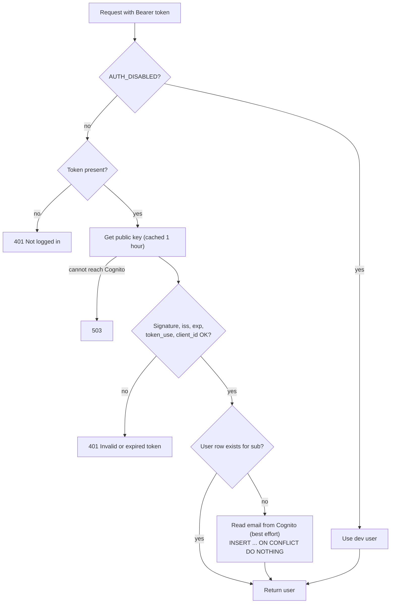

# Feature 1: Login check on the API

**Status:** Built. Branch `feat/users-and-login`.
**Files:** `backend/app/auth.py`, `backend/app/config.py`, `backend/app/routers/me.py`, `backend/app/main.py`, `backend/app/models.py` (`User`), `backend/alembic/versions/0003_add_users.py`, `backend/tests/test_auth.py`.

## 1. What it does

Before this feature, the API had no login. Each person who could reach the API URL could read, change and delete all the data.

Now the API can answer one question for each request: **"Who is this person?"**

1. The browser sends a token in the header `Authorization: Bearer <token>`.
2. The API checks that the token is real, not expired, and made for this app.
3. The API finds the user row for that token. If the user is new, it creates the row.
4. Routes get the user with one line: `user: CurrentUser`.

`GET /api/me` is the first route that uses this. It returns the logged-in user. The frontend uses it to know if login worked.

This feature does **not** yet hide data between users. That is Feature 2 (`02-data-per-user.md`).

## 2. Why this solution

### The problem

The app will be on the internet. Other persons will use it. Each person has a resume and job data that is private. Also, each AI request costs money. An open API is not safe.

### Choice 1: Use Cognito. Do not build our own login.

| Option | Good | Bad |
|---|---|---|
| **Cognito (chosen)** | Part of AWS, so it is in the same bill and the same Terraform code. Free for the first 10,000 users per month. It stores the passwords, sends the emails, and has a login page. Supports "invite only". | The login page looks plain. The settings are confusing at first. |
| Own login (passwords in our database) | Full control. | We would store passwords. Many things can go wrong: hashing, reset emails, rate limits, brute-force attacks. A mistake here is a data leak. |
| Auth0 / Clerk / Supabase Auth | Easy to use. | A second company and a second bill. It does not teach AWS, and learning AWS is the goal of this project. |

The main reason: **we never store or see a password.** Cognito does that. Our API only checks a signed token.

### Choice 2: Check the token inside the API with PyJWT

A Cognito token is a JWT (a signed text). Cognito signs it with a **private key**. Cognito shows the matching **public keys** at a public URL (the JWKS). The API downloads the public keys. With them, the API can check a token, but it cannot make one.

So the API does not call Cognito for each request. It checks the signature on its own. This is fast, and it works even if Cognito is slow.

| Option | Reason |
|---|---|
| **PyJWT (chosen)** | Small, well-kept, and has `PyJWKClient`. That class downloads the public keys and keeps them in memory (we keep them for 1 hour). |
| python-jose | It was the common choice in the FastAPI guides, but it is not well kept now. |
| Authlib | Good, but large. We need only one function. |
| API Gateway authorizer | It would check the token before our code. But it adds a service and a cost, and our code still needs the user. |

### Choice 3: Accept the *access token* only (not the ID token)

Cognito gives two tokens. The **ID token** says who the user is (it has the email). The **access token** is the one that is meant to be sent to an API. We accept only the access token. The code checks `token_use == "access"`. A stolen ID token does not work on the API.

The access token has no email. So the first time we see a new user, the API calls Cognito `/oauth2/userInfo` one time, to read the email. If this fails, the email stays empty and the user can still log in. The email is not needed for security. We use it only to show who is logged in.

### Choice 4: What the API checks on each token

| Check | Why |
|---|---|
| Signature with the public key | Proves that Cognito made the token. |
| `algorithms=["RS256"]` only | Blocks the "alg none" attack and the "HS256 with the public key" attack. We never trust the algorithm in the token header. |
| `iss` (issuer) equals our user pool | Proves the token is from **our** pool, not another pool. |
| `exp` (expiry) | A stolen token stops working after a short time. |
| `token_use == "access"` | Blocks ID tokens. |
| `client_id` equals our app client | Proves the token was made for **this app**. (An access token has no `aud`, so `client_id` is the correct check.) |
| `sub` exists | `sub` is the permanent id of the user in Cognito. We save it in `users.cognito_sub`. |

We match users by `sub`, **not by email**. A user can change the email. The `sub` never changes.

### Choice 5: Create the user with `ON CONFLICT DO NOTHING`

On the first load, the browser sends many requests at the same time (the list, the stats, and the profile). All of them are the "first request" of a new user. If each one runs `INSERT`, all but one would crash on the unique key. With `ON CONFLICT DO NOTHING` the extra inserts do nothing, and then every request reads the same row. A test checks this (`test_user_is_not_duplicated_by_parallel_first_requests`).

### Choice 6: The dev switch `AUTH_DISABLED`

We still need `task dev` to work on a laptop with no internet and no Cognito. With `AUTH_DISABLED=true`, every request runs as one fixed user (`dev-user`).

A switch like this is dangerous if it reaches production. So there are two guards:

1. The default is `false`. If the setting is missing, login is **on** (the safe way).
2. At start-up, the API runs `settings.check_auth_config()`:
   - `ENVIRONMENT=production` with `AUTH_DISABLED=true` → the API **refuses to start**.
   - Login on, but `COGNITO_REGION`, `COGNITO_USER_POOL_ID` or `COGNITO_APP_CLIENT_ID` is empty → the API **refuses to start**.

It is better for the deploy to fail at once than to run with an open API.

### Choice 7: 401 and 503 are different

- Bad, missing or expired token → **401**. The frontend will send the user to the login page.
- The API cannot download the public keys (Cognito is not reachable) → **503**. This is not the fault of the user, so the frontend must not log the user out.

## 3. How a request moves

The key download is blocking code, so the API runs it with `asyncio.to_thread`. Then one slow download does not block the other requests.

## 4. The `users` table

| Column | Type | Note |
|---|---|---|
| `id` | UUID | Our own id. Other tables will point to this. |
| `cognito_sub` | text, unique, indexed | The id from Cognito. We search by this on each request. |
| `email` | text, can be empty | For display only. |
| `created_at` | timestamp | |

Migration: `0003_add_users.py`. It only adds a table, so it is safe to roll back (expand step).

## 5. Tests (`tests/test_auth.py`)

The tests make their own RSA key and sign their own tokens. They replace the key download with that key. So the tests need no internet and no Cognito.

| Test | Proves |
|---|---|
| no token | 401, with `WWW-Authenticate: Bearer` |
| valid token, two times | The same user, not two rows |
| two different `sub` | Two different users |
| expired, wrong issuer, wrong client, no client, ID token, no `sub` | Each gives 401 |
| signed by another key | 401 |
| `alg: none` token | 401 |
| garbage text | 401 |
| key download fails | 503 |
| email from Cognito | Saved for a new user |
| `AUTH_DISABLED` | The dev user is used |
| 5 parallel first requests | One user row |
| production + `AUTH_DISABLED` | The start-up check fails |
| login on, settings empty | The start-up check fails |
| app start | The check really runs in the `lifespan` |

## 6. Settings

| Setting | Meaning | Local dev | Production |
|---|---|---|---|
| `AUTH_DISABLED` | Skip login, use the dev user | `true` | `false` |
| `ENVIRONMENT` | `development` or `production` | `development` | `production` |
| `COGNITO_REGION` | For example `eu-central-1` | empty | set |
| `COGNITO_USER_POOL_ID` | For example `eu-central-1_AbC123` | empty | set |
| `COGNITO_APP_CLIENT_ID` | The app client id | empty | set |
| `COGNITO_DOMAIN` | The hosted UI domain | empty | set |
| `GIT_SHA` | Version, for the health check later | `dev` | set by the deploy |

`.env.example` has these. I also added `AUTH_DISABLED=true` to your local `backend/.env` (this file is not in git), so `task dev` works as before.

## 7. What this feature does not do (yet)

- It does not separate the data of users. → Feature 2.
- It has no login page in the browser. → Feature 3.
- It does not make Cognito. → Terraform, Step 5 of the implementation guide. Until then, only the dev user exists.
- It does not remove a user when the user is removed in Cognito. The row stays. `DELETE /api/me` (Feature 2) removes the data.
