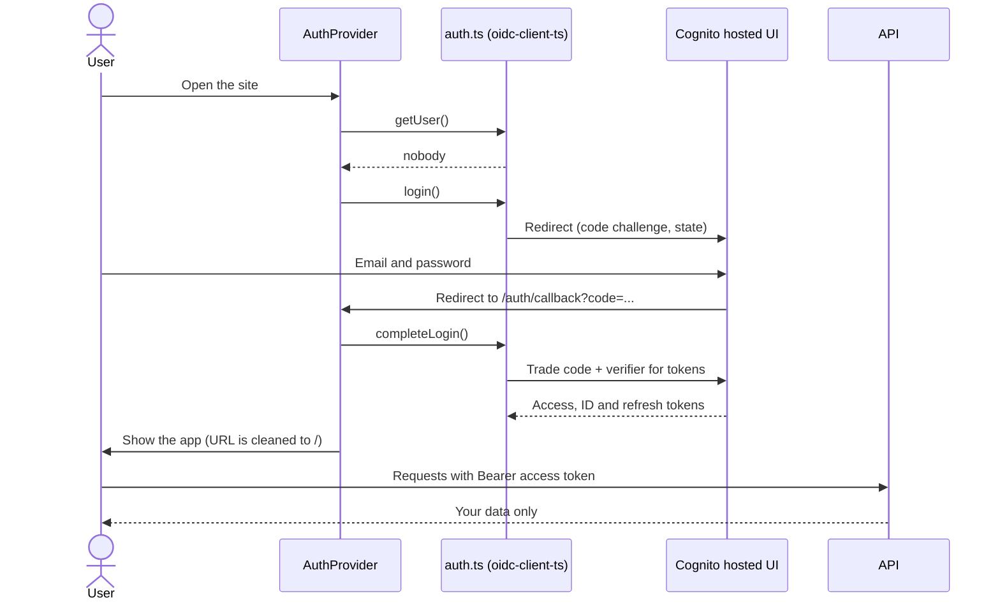

# Feature 3: Login in the browser

**Status:** Built and tested with login **off** (local development). The real login with Cognito is **not tested yet**, because the Cognito user pool does not exist yet. It is created by Terraform (Step 5 of the implementation guide). See section 7 for how to test it.
**Files:** `frontend/src/auth/auth.ts`, `frontend/src/auth/AuthProvider.tsx`, `frontend/src/auth/session.ts`, `frontend/src/api/client.ts`, `frontend/src/main.tsx`, `frontend/src/App.tsx`, `frontend/.env.development`, `frontend/.env.example`.

## 1. What it does

1. When you open the site and you are not logged in, the browser goes to the Cognito login page.
2. You enter your email and password there. (The first time: the temporary password from the invitation email, then a new password.)
3. Cognito sends the browser back to `/auth/callback` with a one-time code.
4. The app trades the code for tokens, and shows the normal screen.
5. Each request to `/api/...` now has the header `Authorization: Bearer <access token>`.
6. The top bar shows your email and a **Log out** button.
7. If the API answers **401**, the app sends you to the login page again.

Locally, nothing changes: `task dev` does not ask for a login (see section 4).

## 2. Why this solution

### Choice 1: Hosted UI + authorization code flow with PKCE

| Option | Reason |
|---|---|
| **Cognito hosted UI + code flow + PKCE (chosen)** | The password is typed on a page of Cognito, **not in our app**. Our code never touches a password. PKCE protects the code: only the browser that started the login can finish it. This is the method that the OAuth security guidance recommends for browser apps. |
| Own login form that calls the Cognito API (SRP) | We would build and keep the form, the errors, "new password required", "forgot password", and so on. More code and more risk. |
| Implicit flow (token in the URL) | Old and not safe. Not recommended any more. |
| Amplify UI components | Large library, with many features we do not use. |

The hosted UI looks plain. It is fine for an invite-only app. (Cognito can show a logo and colors later.)

### Choice 2: `oidc-client-ts`, not `aws-amplify`

The plan allowed both. I chose `oidc-client-ts`:

- It is small, and it only does OpenID Connect. Cognito is an OpenID Connect provider, so it fits without special code.
- It does PKCE, the code trade, the refresh of tokens, and the state check for us.
- It is not tied to AWS. If we change to another login provider later, only the settings change.
- `aws-amplify` is a large framework. We would use only the login part of it.

I wrote about 100 lines of our own code on top of it, in `src/auth/`.

### Choice 3: Send the *access token* to the API

The library gives an ID token and an access token. We send the **access token** to the API, because this is the token that Feature 1 accepts (and it refuses an ID token). The browser only reads the email from the ID token, to show it in the top bar.

### Choice 4: Tokens in `sessionStorage`

| Option | Good | Bad |
|---|---|---|
| **`sessionStorage` (chosen)** | The tokens are gone when the tab closes. Smaller damage if a token is stolen. | A new tab needs a new login. But Cognito remembers you, so it is only a fast redirect with no password. |
| `localStorage` | You stay logged in for days. | The tokens stay on the disk. A stolen token works for longer. |
| Cookie (httpOnly) | The best against script attacks. | Needs a backend session service. More parts. |

In the browser, no storage is safe from a script attack (XSS). So the best protection is to have **no XSS**: React escapes text by default, and the app has no `innerHTML` or `dangerouslySetInnerHTML` (I searched `frontend/src`). I chose the storage with the shortest life.

### Choice 5: Refresh the token without a login page

`automaticSilentRenew: true`. A Cognito access token lives for 1 hour. The library uses the refresh token to get a new one before the old one ends. So you are not sent to the login page every hour.

### Choice 6: One place adds the token (a middleware)

`openapi-fetch` (already used in the project) has middleware. `src/api/client.ts` adds one middleware:

- `onRequest`: add the `Authorization` header.
- `onResponse`: on **401**, go to the login page.

All the hooks in `src/hooks/useApplications.ts` use this `api` object, so they get the token **without any change**. This follows the rule in `CLAUDE.md`: components do not call `api` directly.

**503 is not handled like 401.** A 503 means the login service of Cognito is down (Feature 1). It does not mean that you are logged out, so we do not redirect.

### Choice 7: Cognito has its own logout address

Most login providers have a standard "end session" address. Cognito does not. Its logout address is `https://<domain>/logout?client_id=...&logout_uri=...`. So `logout()` does two things: it removes the tokens in the browser, and then it opens the Cognito logout address to end the Cognito session. The `logout_uri` must be in the list of allowed sign-out URLs of the app client (Terraform sets it).

### Choice 8: Login is on by default in production

Local development needs no login. But a switch that turns off the login is dangerous if it reaches production. So:

- `VITE_AUTH_DISABLED=true` is in `frontend/.env.development`. Vite reads this file **only** for `npm run dev`. A production build (`npm run build`) never reads it, so login is **on** even if nobody sets anything.
- If login is on but the Cognito settings are missing, the app shows a clear error. It does not run without login.
- The backend also refuses to start in production with `AUTH_DISABLED=true` (Feature 1). So there are two separate guards.

### Choice 9: A guard for React StrictMode

In development, React runs effects two times. A login code can be used only once, so the second trade would fail and show an error. `AuthProvider` keeps one shared start-up promise (`starting`), so the code trade runs once.

## 3. How a login moves

## 4. Settings

| Variable | Where | Meaning |
|---|---|---|
| `VITE_AUTH_DISABLED` | `frontend/.env.development` (in git) | `true`: no login on `npm run dev` |
| `VITE_COGNITO_REGION` | build settings | For example `eu-central-1` |
| `VITE_COGNITO_USER_POOL_ID` | build settings | For example `eu-central-1_AbC123` |
| `VITE_COGNITO_APP_CLIENT_ID` | build settings | The client id of the app |
| `VITE_COGNITO_DOMAIN` | build settings | The hosted UI domain, without `https://` |

`VITE_` values are put in the JavaScript file at build time, so everyone can read them. This is fine: none of them is a secret. (The app client has **no client secret**, because a browser app cannot keep one. PKCE replaces it.) `frontend/.env.example` shows the format. The deploy workflow will set them during `npm run build`.

## 5. What was changed

| File | Change |
|---|---|
| `src/auth/auth.ts` (new) | Cognito settings, `getAccessToken`, `getUser`, `login`, `completeLogin`, `logout` |
| `src/auth/AuthProvider.tsx` (new) | Shows the app only after login. Handles the callback and errors ("Try again" button). |
| `src/auth/session.ts` (new) | `useSession()`: the email and the logout function, for the top bar |
| `src/api/client.ts` | Middleware: add the token, and handle 401 |
| `src/main.tsx` | Wraps the app in `AuthProvider` |
| `src/App.tsx` | Shows the email and the **Log out** button |
| `frontend/.env.development`, `frontend/.env.example` (new) | Settings |
| `package.json` | New package `oidc-client-ts` |

## 6. How it was checked

- `npm run lint` and `npm run build` (this includes the type check) pass.
- I started the real backend and the real Vite dev server, with login off. The page, `/api/applications` through the proxy, `/api/me`, and the `/auth/callback` path all answer 200.
- The backend refuses to start with `ENVIRONMENT=production` and `AUTH_DISABLED=true`. It also refuses to start with login on and no Cognito settings.

## 7. What is **not** checked yet (please read)

The real login with Cognito needs a real user pool. The project has no such pool until Terraform creates it. So I could not run these:

- the redirect to the hosted UI, and back
- the token trade
- the silent token refresh
- the Cognito logout address

There is also no automated test for the frontend (the project has no frontend test tool). **When Terraform has created the pool, do this check by hand:**

1. Build the frontend with the four `VITE_COGNITO_*` values and open it.
2. You must be sent to the Cognito login page.
3. Log in as an invited user. You must come back to the app, and the URL must be `/`.
4. Open the browser developer tools, Network tab. `/api/...` requests must have `Authorization: Bearer ...` and return 200.
5. Click **Log out**. You must land on the site, and then be sent to the login page again.
6. Check that a second user cannot see the data of the first (the isolation tests prove this on the API, but check once with the real login).

## 8. Limits and later work

- The access token is valid for 1 hour (the Cognito default). Terraform can change this.
- There is no "forgot password" screen in our app. The Cognito hosted UI has one.
- There is no sign-up screen on purpose: the app is **invite-only**. An admin invites a user (`aws cognito-idp admin-create-user`, see the implementation guide, Step 7).
